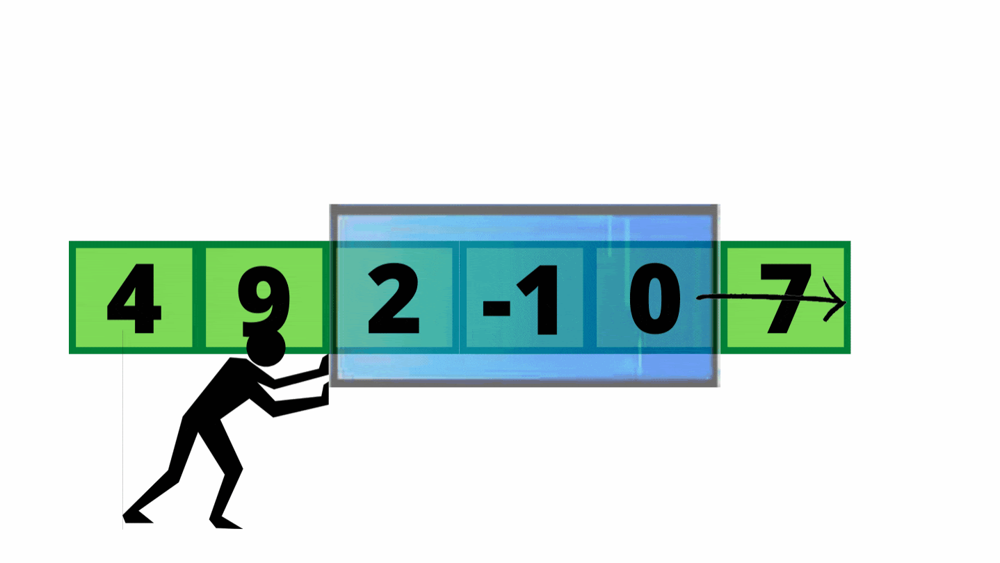

# What is Sliding Window?

A sliding window is a sub-array or range-based technique used to reduce nested loops into O(n) or O(n log n) solutions.

It is typically applied to:

* Arrays
* Strings
* Lists



## Types

| Type                     | Description                            | Use Case                                             |
|--------------------------|----------------------------------------|------------------------------------------------------|
| **Fixed Size Window**    | Window size is constant                | Max sum of size K                                    |
| **Variable Size Window** | Window size changes dynamically        | Longest substring with at most K distinct characters |
| **Monotonic Window**     | Maintains max/min using deque          | Sliding window maximum                               |
| **Two Pointer Window**   | Adjusts start and end using conditions | Longest substring without repeating chars            |

## 1. Fixed Size Window

A fixed-size sliding window involves keeping a subarray of fixed length k, and you move the window one element at a time
through the array.

Used when:
You need the result (sum, max, average, etc.) of every subarray of length k.

| Concept          | Description                                             |
|------------------|---------------------------------------------------------|
| **Window Size**  | Always `k`                                              |
| **Add Right**    | Add `arr[i]`                                            |
| **Remove Left**  | Remove `arr[i - k]`                                     |
| **No Shrinking** | Window size never changes                               |
| **O(n)**         | Linear time — because each element added & removed once |

```
int maxSum = 0, windowSum = 0;
for (int i = 0; i < k; i++) windowSum += arr[i];

maxSum = windowSum;
for (int i = k; i < arr.length; i++) {
    windowSum += arr[i] - arr[i - k];
    maxSum = Math.max(maxSum, windowSum);
}
```
## 1. Understand the problem

Suppose we have this array:

``` java
int[] arr = {2, 1, 5, 1, 3, 2};
int k = 3;
```

We want to find the **maximum sum of any continuous subarray of size
3**.

That means we select exactly 3 consecutive elements and calculate their
sum.

The first window is:

``` text
[2, 1, 5]  1  3  2
```

Its sum is:

``` text
2 + 1 + 5 = 8
```

The window size is always `k`, which is 3.

## 2. How does the window move?

This is the most important part.

Initially:

``` text
[2, 1, 5]  1  3  2
```

Window sum = 8.

Now move the window one position to the right:

``` text
2  [1, 5, 1]  3  2
```

Notice what happened:

-   The element `2` left the window.
-   The element `1` entered the window.

Instead of calculating `1 + 5 + 1` from scratch, update the previous
sum:

``` text
Old sum = 8
Remove 2: 8 - 2 = 6
Add 1:    6 + 1 = 7
```

New window sum = **7**.

Move again:

``` text
2  1  [5, 1, 3]  2
```

-   Remove `1`.
-   Add `3`.

``` text
7 - 1 + 3 = 9
```

New window sum = **9**.

Move one more time:

``` text
2  1  5  [1, 3, 2]
```

-   Remove `5`.
-   Add `2`.

``` text
9 - 5 + 2 = 6
```

New window sum = **6**.

## 3. Complete window movement

  Window   Elements     Sum
  -------- ---------- -----
  1        2, 1, 5        8
  2        1, 5, 1        7
  3        5, 1, 3        9
  4        1, 3, 2        6

The maximum sum is **9**.

The important observation: after calculating the first window, we never
calculate another complete window sum from scratch. We only remove the
outgoing element and add the incoming element.

That is the main idea of the fixed-size sliding window.

## 4. Understand the Java code

### Part A: Calculate the first window

``` java
int maxSum = 0, windowSum = 0;

for (int i = 0; i < k; i++) {
    windowSum += arr[i];
}
```

This loop calculates the sum of the first `k` elements.

For our example:

``` text
arr = [2, 1, 5, 1, 3, 2]
       └─────┘

windowSum = 2 + 1 + 5 = 8
```

We need this initial window before we can start sliding.

### Part B: Store the first window's sum

``` java
maxSum = windowSum;
```

Now:

``` text
windowSum = 8
maxSum    = 8
```

We treat the first window as the maximum until we find a larger sum.

### Part C: Start sliding

``` java
for (int i = k; i < arr.length; i++) {
    windowSum += arr[i] - arr[i - k];

    maxSum = Math.max(maxSum, windowSum);
}
```

The most important line is:

``` java
windowSum += arr[i] - arr[i - k];
```

It does two things:

-   `arr[i]` is the new element entering the window.
-   `arr[i - k]` is the old element leaving the window.

### Why do we use `i - k`?

Let's examine the first sliding operation.

Initially:

``` text
i = 3
k = 3
```

Therefore:

``` java
arr[i]     = arr[3] = 1; // Entering element
arr[i - k] = arr[0] = 2; // Leaving element
```

So the update is:

``` java
windowSum += 1 - 2;
```

Which gives:

``` text
8 + 1 - 2 = 7
```


## 2. Variable Size Window

Unlike fixed size, where window size is constant (like k), in variable size, the window grows or shrinks based on a
condition.

#### The general steps to solve these questions by following below steps:

* In this type of sliding window problem, we increase our right pointer one by one till our condition is true.
* At any step if our condition does not match, we shrink the size of our window by increasing left pointer.
* Again, when our condition satisfies, we start increasing the right pointer and follow step 1.
* We follow these steps until we reach to the end of the array.


**Template simple**
```
int i = 0, j = 0; // i = start, j = end
while (j < n) {
// 1. Expand the window by moving j
// Add nums[j] or process nums[j]

    // 2. If condition is NOT met
    while (invalidCondition) {
        // Shrink the window from the left
        // Remove nums[i] or reverse the effect
        i++;
    }

    // 3. When condition is met, update result
    // Possibly: result = max/min/count...

    j++;
}
```
| Problem                   | Keyword             | Example                                       |
|---------------------------|---------------------|-----------------------------------------------|
| Longest/Shortest subarray | based on sum, chars | Subarray with sum ≤ K                         |
| Count of subarrays        | with constraint     | At most K distinct characters                 |
| Frequency                 | unique chars/count  | Longest substring with at most K unique chars |
